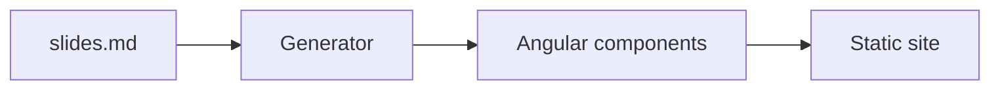

# A tour of slide.ng

Markdown in, Angular out

<!--
Notes are the last HTML comment of a slide. They show up in the presenter view.
-->

---

# Clicks

Press the right arrow or space.

<v-clicks>

- the first item
- the second item
- the third item

</v-clicks>

<div v-click class="mt-6 text-xl">And a block that shows on the next click.</div>

---
layout: two-cols
---

# Left

Markdown on this side, and Angular too: 6 x 7 = {{ 6 * 7 }}.

::right::

# Right

```ts {1|2-3|all}
const greet = (name: string) => `Hello ${name}`;
const message = greet('slide.ng');
console.log(message);
```

---

# Math

Inline math like $\sqrt{3x-1}+(1+x)^2$ sits in the text.

$$ {1|2|all}
\begin{aligned}
\nabla \cdot \vec{E} &= \frac{\rho}{\varepsilon_0} \\
\nabla \cdot \vec{B} &= 0
\end{aligned}
$$

---

# A diagram



---
layout: center
class: text-center
---

# Marks and templates

This is <span v-mark.red.circle="1">circled</span> at the first click,
and <span v-mark.underline="2">underlined</span> at the second.

@let total = 3;

There are {{ total }} clicks on this slide.

---
layout: end
---
