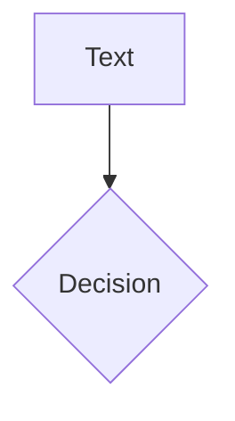

# Mermaid

*Mermaid diagrams are drawn in the browser, and the library is loaded only when a deck has one. Options come after the language:

````md

````

- `theme` defaults to `dark` or `default`, following the colour mode.
- Any other key is passed to Mermaid's own `initialize`. Options may be nested, as in `{sequence: {mirrorActors: false}}`.
- In the PDF, a diagram taller than the slide is kept, and a diagram with a syntax error does not add a page.
- `<slide-ng-mermaid code="..." />` works as a tag too.
- While a diagram is being drawn its element has `data-slide-ng-waitfor`, and the attribute goes away when the picture is there. The exporter waits for it.

A `setup/mermaid.ts` file returns Mermaid's config for every diagram. A `setup/mermaid-renderer.ts` file draws the diagrams with another library, or with Mermaid in another way. See [Setup hooks](../customize/setup-hooks.md#mermaid-renderer).
