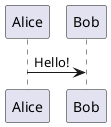

# PlantUML

PlantUML is a picture from a PlantUML server, so the browser needs the network.

````md

````

Set the server in the headmatter. The default is the public one:

```md
---
plantUmlServer: https://www.plantuml.com/plantuml
---
```

PlantUML does not work in an [offline folder](../guide/offline.md).
