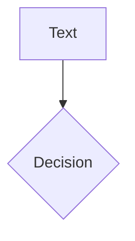
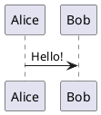

# Diagrams and math

## Math

*KaTeX draws math while the deck is generated. `$...$` is inline and `$$ ... $$` is a block.

```md
Inline $\sqrt{3x-1}+(1+x)^2$

$$ {1|2|all}
\begin{aligned}
\nabla \cdot \vec{E} &= \frac{\rho}{\varepsilon_0} \\
\nabla \cdot \vec{B} &= 0
\end{aligned}
$$
```

`{1|2|all}` after the opening `$$` steps through the formula's lines with clicks, with the same range syntax as code. The text of inline math follows Slidev's rule, so `$5 and $10` stays text. KaTeX's CSS and fonts are only part of the build when a deck uses math. More in [Math](../features/math.md).

## Mermaid

*Mermaid diagrams are drawn in the browser, and the library is only loaded when a deck has one. Options come after the language:

````md

````

See [Mermaid](../features/mermaid.md).

## PlantUML

PlantUML is a picture made by a PlantUML server, so the browser needs the network.

````md

````

See [PlantUML](../features/plantuml.md).
